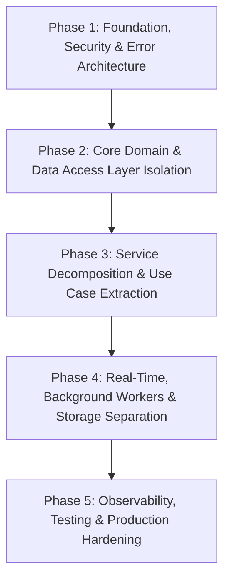

# Technical Audit & Architecture Review: Logistics Dispatch Service

**Role**: Principal Software Architect  
**Audit Target**: `logistics-dispatch-service` Backend Codebase  
**Date**: July 2026  
**Status**: Completed Technical Audit & Foundation Assessment  

---

## Executive Summary

This document presents a comprehensive, deep-dive architectural and engineering audit of the `logistics-dispatch-service` backend codebase. The purpose of this audit is to evaluate the existing system against production-grade software engineering standards, identify structural and architectural vulnerabilities, evaluate SOLID principles and Clean Code compliance, and propose a concrete refactoring roadmap to transform the project into a portfolio-quality enterprise backend.

---

## 1. Project Architecture

### Current Architecture Style
The project claims a layered architecture structure (`controllers` -> `services` -> `prisma/redis`), but in reality, it exhibits an **Anemic Domain Model** governed by **Transaction Scripts** wrapped in a loose Express container. 

Key attributes observed:
- **No Domain Boundary**: Business logic resides entirely within static method procedural scripts in `src/services/` (`PackageService`, `DriverService`, `ZoneService`).
- **Anemic Models**: The files under `src/models/` (`driver.model.ts`, `package.model.ts`, `user.model.ts`, `zones.model.ts`) contain trivial, out-of-sync TypeScript interfaces (e.g., `Driver` in `driver.model.ts` contains `email: string` and `zoneIds: string[]`, which **do not exist** in the Prisma schema or DB!). These models carry zero domain logic, zero validation, and zero invariants.
- **Inconsistent Layering**: 
  - Controllers contain direct database queries (`prisma.$queryRaw\`SELECT 1\`` in `admin.controller.ts`).
  - Services handle HTTP status translation, file I/O operations (`saveBase64Image`), WebSocket broadcasts (`emitToRoom`), and external HTTP calls (`geocodeAddress`).
  - Public routes (`public.routes.ts`) contain inline request handling logic with `eventBus` subscriptions and raw SSE streaming headers rather than delegating to a controller or application service.

```
Current Flow (Coupled & Direct Dependency):
[ HTTP Request ] -> [ Route ] -> [ Controller / Route Inline ] 
                                          |
                        +-----------------+-----------------+
                        |                 |                 |
                [ Static Service ]  [ Direct Prisma ] [ Raw Filesystem ]
                        |
       +----------------+----------------+
       |                |                |
 [ Prisma ORM ]  [ Redis Pub/Sub ] [ Socket.io Room ]
```

### Module & Folder Organization
The folder structure uses a **Technical Layering** layout (`controllers`, `routes`, `services`, `schemas`, `models`, `middlewares`, `utils`). This layout separates files by technical responsibility rather than domain feature boundaries (Domain/Vertical Slices).

### Coupling & Cohesion
- **Coupling**: Extremely High. Services are tightly coupled to concrete singleton instances (`prisma`, `redis`, `eventBus`, global `io` socket functions). Re-assigning or testing any single service requires mounting a real Postgres database and a real Redis instance.
- **Cohesion**: Very Low. `PackageService` is a 612-line "god service" handling multi-tenant querying, geocoding, geofencing, file disk persistence for signatures/photos, SSE event mapping, dashboard telemetry calculation with in-memory aggregations, and socket event broadcasting.

### Architectural Classification
The codebase is **Inconsistent / Pseudo-Layered with Anemic Domain Models**. It fails to conform to Clean Architecture, Hexagonal (Ports & Adapters), or Modular Monolith principles due to the lack of dependency inversion, absent domain entities, and direct coupling to infrastructure drivers.

---

## 2. Module Analysis

| Module Name | Responsibilities | Dependencies | Strengths | Weaknesses | Refactoring Strategy |
| :--- | :--- | :--- | :--- | :--- | :--- |
| **Admin** | System health metrics, process memory, DB ping, Redis ping, socket client counts. | `prisma`, `redis`, `websocket`, `eventBus`, `process`. | Quick overview endpoint. | Directly queries DB from controller; uses `process.env` directly; ping logic is fragile. | Move system metrics collection into an Application Monitoring Service. |
| **Auth** | Tenant registration, user login, JWT generation, password hashing. | `bcrypt`, `jwt`, `prisma`. | Atomic transaction for tenant creation (`registerCompany`). | Throws string literals (`"user_not_found"`), leaks internal errors, relies on raw `process.env` for JWT secret. | Extract Auth Domain use cases, introduce Domain Exceptions & Auth Provider interface. |
| **Driver** | Driver CRUD, zone assignment, GPS location buffering, DB sync worker. | `prisma`, `redis`, `websocket`. | Implements write-back GPS buffering using Redis hash rename. | Worker interval runs inside HTTP process; incomplete multi-tenant verification in `getDriverZones`; invalidates cache using fragile prefix wildcards. | Separate GPS Ingestion worker from API process; introduce Driver Repository; formalize Domain Events. |
| **Package** | Package lifecycle management, tracking, status transitions, geocoding fallback, POD handling, dashboard stats. | `prisma`, `websocket`, `geocoder`, `fileUpload`, `zone.service`. | Comprehensive features (POD, tracking, stats). | Massively overloaded (612 lines); in-memory aggregation of weekly metrics; disk storage for POD images coupled to service; stringly-typed error handling. | Split into `PackageManagementService`, `PackageTrackingService`, `PODService`, and `DashboardAnalyticsService`. |
| **Zone** | Zone creation, polygon updates, geofencing detection, bulk status toggles. | `prisma`, `redis`, `geofencing`. | Implements Ray-Casting algorithm for point-in-polygon geofencing. | Auto-activation triggers package status updates without transaction safety; direct static calls between services. | Introduce Spatial/Zone Domain Entity; decouple Package updates via Domain Events (`ZoneActivatedEvent`). |
| **EventBus** | Ephemeral Redis Pub/Sub wrapper for driver location updates. | `redis`, Node `events`. | Singleton wrapper preventing multiple Redis subscriptions. | Global error logging suppresses failures; no retry or reconnection strategy; tightly coupled to raw JSON payloads. | Convert to formal Event Broker port/adapter with structured Event Enums. |
| **WebSocket** | Real-time Socket.io rooms per company (`company-{id}`). | `socket.io`, `jwt`, `logger`, `eventBus`. | JWT authentication during socket handshake; multi-tenant room isolation. | Reads `process.env.JWT_SECRET` directly ignoring `env.ts`; handshake error handling leaves hanging client sockets; duplicate token parsing logic. | Abstract WebSocket gateway behind a Real-Time Event Publisher port. |
| **Utils (Geocoder/Geofencing)** | OSM, Google, Mapbox geocoding; ray-casting polygon detection; base64 image disk writer. | `axios`, `fs`, `path`, `prisma`. | Multi-provider fallback chain for geocoding. | Hardcoded fallback cities (`"Cordoba, Argentina"`); synchronous file writes (`fs.writeFileSync`) blocking Node event loop. | Convert Geocoder to an Adapter implementing a `IGeocoderPort`; make POD storage async with Cloud/S3 adapters. |

---

## 3. SOLID Principles Review

### 1. Single Responsibility Principle (SRP) — VIOLATED
- **Where**: `PackageService` (`src/services/package.service.ts`), `public.routes.ts`, `app.ts`.
- **Why**: `PackageService` is responsible for persistence, business rules, geocoding HTTP calls, file system image creation, WebSocket notification, and telemetry reporting. `public.routes.ts` handles HTTP routing, request parsing, SSE stream management, heartbeat timers, and EventBus listener subscriptions.
- **Impact**: Any change to file upload paths, tracking response schemas, or socket events breaks `PackageService`. High risk of regression.
- **Recommendation**: Decompose into single-purpose components (Use Cases, Domain Services, Infrastructure Adapters).

### 2. Open/Closed Principle (OCP) — VIOLATED
- **Where**: `src/utils/geocoder.ts`, status transitions in `PackageService`.
- **Why**: Geocoding provider fallbacks (OSM, Google, Mapbox) are hardcoded with nested `if` statements. Adding a new provider (e.g., Here Maps) requires editing `geocoder.ts`. Package status transitions are controlled by a static inline `Record<PackageStatus, PackageStatus[]>`.
- **Impact**: Code modification is required for every new provider or status state machine rule.
- **Recommendation**: Implement Strategy Pattern for Geocoding (`IGeocodingProvider`) and State Pattern for Package Status Lifecycle.

### 3. Liskov Substitution Principle (LSP) — VIOLATED
- **Where**: Redis client wrapper in `src/redis.ts`.
- **Why**: `redis.get` returns `null` when Redis is disabled or closed, but `redis.rename` throws an unhandled error or returns boolean, and `hGetAll` returns `{}`. The wrapper does not adhere to a standard cache contract.
- **Impact**: Calling code cannot seamlessly substitute the real Redis implementation with an In-Memory cache implementation without subtle runtime bugs.
- **Recommendation**: Formalize an `ICacheService` interface with strict return types and error contracts.

### 4. Interface Segregation Principle (ISP) — VIOLATED
- **Where**: `src/models/*.model.ts` vs Prisma Client generated types.
- **Why**: The app forces controllers and services to work with monolithic Prisma objects (including full relations) or overly reduced interfaces that do not match runtime representations.
- **Impact**: Consumers depend on fields they do not use, leading to over-fetching or unexpected `undefined` access.
- **Recommendation**: Define lean, consumer-specific DTOs and Domain Entity interfaces.

### 5. Dependency Inversion Principle (DIP) — VIOLATED
- **Where**: Entire codebase (`services/*`, `controllers/*`, `routes/*`, `websocket.ts`).
- **Why**: High-level modules (`PackageService`, `DriverService`) directly import concrete low-level infrastructure singletons (`import { prisma } from "../prisma"`, `import { redis } from "../redis"`).
- **Impact**: Zero modularity. Unit testing without an active PostgreSQL/Redis instance is impossible.
- **Recommendation**: Inject abstract Repositories and Services via Dependency Injection (DI) using lightweight constructor injection or a DI container.

---

## 4. Clean Code & Code Smells Analysis

### Code Smells Identified

1. **Stringly-Typed Error Handling**:
   - `throw new Error("username_taken")`, `throw new Error("package_not_found")`, `throw new Error("invalid_transition:pending:delivered")`.
   - Controllers manually parse error messages using `error.message === "user_not_found"` or `error.message.startsWith("invalid_transition")`.
   - **Impact**: Extremely fragile. A typo in a string breaks HTTP status codes silently (falling back to 500 Internal Server Error).

2. **Bypassed Configuration Schema**:
   - `src/config/env.ts` defines a validated Zod environment schema.
   - However, `auth.middleware.ts`, `websocket.ts`, `geocoder.ts`, `redis.ts`, `app.ts`, and `admin.controller.ts` directly read `process.env.JWT_SECRET`, `process.env.REDIS_ENABLED`, etc.
   - **Impact**: Renders Zod validation useless; missing environment variables cause silent runtime failures or undefined behavior instead of failing at boot.

3. **Event Loop Blocking Synchronous I/O**:
   - `saveBase64Image` in `src/utils/fileUpload.ts` uses `fs.mkdirSync` and `fs.writeFileSync`.
   - **Impact**: Under concurrent load, decoding large base64 images and writing them synchronously blocks the single-threaded Node.js event loop, spiking API latency for all users.

4. **In-Memory Analytics Aggregation**:
   - `PackageService.getDashboardStats` fetches all package records delivered or cancelled in the last 7 days (`findMany`) and aggregates them in memory using `Map` objects and JavaScript `.reduce()`.
   - **Impact**: As dataset size grows to 100,000+ packages, this operation will cause severe memory bloat, high GC overhead, and database query timeouts.

5. **Non-Null Assertions & Loose Typing**:
   - Pervasive use of `req.user!` in controllers without explicit TypeScript type guards.
   - Extensive use of `(req as any)`, `(error as any)`, and `data: any` in services and middleware.

6. **Out-of-Sync / Dead Interfaces**:
   - `src/models/driver.model.ts`: Contains `email: string`, which does not exist in Prisma schema!
   - `src/models/package.model.ts`: Misses 15+ real attributes present in Prisma `Package`.

7. **Duplicated & Inconsistent Route Middlewares**:
   - `packages.routes.ts` applies `auth` globally at the top (`router.use(auth)`), but then redundantly attaches `auth` to specific sub-routes (`router.get("/my-packages", auth, ...)`).

---

## 5. Project Structure Audit & Target Proposal

### Current Structure Vulnerabilities
The current folder structure groups by technical type (`controllers/`, `services/`, `models/`). As the project scales, adding a new feature requires editing files across 6 different directories, scattering domain logic and making context switching exhausting.

### Proposed Enterprise Architecture (Modular Clean Architecture)

```
src/
├── app.ts                        # Express application setup & middleware assembly
├── server.ts                     # Server bootstrap & lifecycle management (formerly index.ts)
├── config/                       # Centralized, strongly-typed config
│   ├── env.ts
│   └── constants.ts
├── core/                         # Shared Domain Core & Building Blocks
│   ├── domain/
│   │   ├── Entity.ts
│   │   ├── AggregateRoot.ts
│   │   ├── ValueObject.ts
│   │   └── UniqueEntityID.ts
│   ├── errors/                   # Strongly-typed Domain & App Exceptions
│   │   ├── DomainError.ts
│   │   ├── NotFoundError.ts
│   │   ├── UnauthorizedError.ts
│   │   ├── ConflictError.ts
│   │   └── ValidationError.ts
│   └── logic/
│       ├── Result.ts             # Functional error handling (Result<T, E>)
│       └── UseCase.ts
├── modules/                      # Domain Bounded Contexts (Modular Monolith)
│   ├── identity/                 # Users & Auth Bounded Context
│   │   ├── domain/
│   │   ├── application/          # Use Cases / DTOs
│   │   ├── infrastructure/       # Prisma User Repo, JWT Adapter
│   │   └── presentation/         # Auth Controllers & Routes
│   ├── logistics/                # Package & Tracking Bounded Context
│   │   ├── domain/
│   │   │   ├── entities/         # Package Aggregate, TrackingCode VO
│   │   │   ├── events/           # PackageCreatedEvent, StatusChangedEvent
│   │   │   └── repositories/     # IPackageRepository Interface
│   │   ├── application/          # CreatePackageUseCase, UpdateStatusUseCase
│   │   ├── infrastructure/       # PrismaPackageRepository, LocalFileStorageAdapter
│   │   └── presentation/         # PackageController, PublicTrackingController
│   ├── fleet/                    # Drivers & Location Bounded Context
│   │   ├── domain/               # Driver Entity, GPS Location VO
│   │   ├── application/          # UpdateDriverLocationUseCase, AssignZonesUseCase
│   │   ├── infrastructure/       # RedisLocationBuffer, PrismaDriverRepo
│   │   └── presentation/         # DriverController, LocationWebSocketGateway
│   └── territory/                # Zones & Geofencing Bounded Context
│       ├── domain/               # Zone Entity, Polygon VO, Geofence Engine
│       ├── application/          # DetectZoneUseCase, ManageZoneUseCase
│       ├── infrastructure/       # GeofencingAdapter, PrismaZoneRepo
│       └── presentation/         # ZoneController
└── shared/                       # Cross-cutting Infrastructure
    ├── infrastructure/
    │   ├── database/             # Prisma Client & Migrations
    │   ├── cache/                # Redis Cache Adapter
    │   ├── events/               # EventBus Adapter
    │   ├── logging/              # Winston Logger Adapter
    │   └── telemetry/            # Prometheus Registry
    └── presentation/             # Shared Express Middlewares (Auth, Error, RateLimit)
```

---

## 6. Express Layer Review

### Controllers Analysis
- **Fat Controllers vs. Thin Controllers**: Controllers like `packages.controller.ts` (190 lines) act as parameter extractors and manual error translators. They contain repetitive `try/catch` blocks mapping string errors to status codes.
- **Request Flow**: `HTTP Request -> Route Middleware (auth/validate) -> Controller -> Static Service -> Response`.
- **Response Flow**: Inconsistent. Some endpoints return raw objects (`res.json(pkg)`), others wrapped arrays (`res.json(result)`), and others specific count objects (`res.json({ count: result.count })`). No uniform API envelope (`{ success: true, data: ..., error: null }`).
- **Error Flow**: Controllers catch errors manually, but if an error falls outside explicit string checks, it sends `res.status(500).json({ error: "Internal Server Error" })`. Express's global error handler (`errorHandler`) is bypassed for most application errors!

---

## 7. Business Logic Review

### Leakage of Business Logic
1. **Leaked into Controllers**:
   - `zones.controller.ts`: Evaluates `driverId` mutation logic (mapping `null` vs `undefined` vs string) and parses active status rules.
   - `admin.controller.ts`: Contains health check logic, database ping raw SQL execution, and process memory calculations.
2. **Leaked into Routes**:
   - `public.routes.ts`: Contains 70+ lines of inline stream setup, SSE retry framing (`res.write("retry: 10000\n\n")`), heartbeat interval management, and EventBus listener binding.
3. **Leaked into Database/Prisma Layer**:
   - Implicit logic tied to Prisma cascades and transaction callbacks inside services.

---

## 8. Data Layer Review (Prisma & Database)

### Performance & Query Analysis
1. **Unindexed Queries**:
   - `prisma.user.findUnique({ where: { username } })` -> `username` is `@unique` (indexed). Good.
   - `prisma.package.findFirst({ where: { trackingCode } })` -> `trackingCode` is indexed via `@@unique([trackingCode, companyId])`. But public tracking searches by `trackingCode` alone without `companyId`, causing an index skip or sub-optimal index scan!
   - `prisma.zone.findMany({ where: { companyId, polygon: { not: null } } })` -> No composite index on `(companyId, polygon)`.
2. **N+1 and Over-Fetching**:
   - In `PackageService.getDashboardStats`, multiple database roundtrips are executed sequentially instead of using `Promise.all` or database-level aggregation views (`COUNT`, `AVG` via raw SQL or Prisma groupBy).
3. **Repository Pattern Missing**:
   - Services invoke `prisma.package.findMany`, `prisma.driver.updateMany`, etc., directly. Mocking the database layer for testing requires mocking the entire Prisma Client instance.

---

## 9. Validation Review

### Validation Strategy
- **Zod Usage**: Zod is imported and used in `src/schemas/`.
- **Flaws**:
  - `validate` middleware validates `req.body`, `req.query`, and `req.params` simultaneously against a top-level schema object.
  - Several routes (`zones.routes.ts`, `packages.routes.ts` `/:id` routes) bypass validation middleware entirely, relying on unsafe type assertions in controllers (`req.params.id as string`, `req.body.isActive as boolean`).
  - Query parameters (e.g. `page`, `limit`, `status`) are converted using manual `parseInt` in controllers instead of Zod coercion schemas (`z.coerce.number()`).

---

## 10. Error Handling Review

### Architecture Flaws
- **No Domain Error Hierarchy**: There are no custom error classes (e.g. `DomainException`, `ResourceNotFoundException`, `UnauthorizedException`).
- **Global Error Handler Failure**: `error.middleware.ts` handles Prisma errors (`P2002`, `P2025`) and JWT errors, but because services throw generic `Error("string")` and controllers catch them without re-throwing to `next(err)`, `error.middleware.ts` is rarely executed for application-level failures.

---

## 11. Configuration Review

### Flaws & Magic Values
- **Bypassed Schema**: As noted, `src/config/env.ts` exists but is ignored across multiple files.
- **Magic Strings & Numbers**:
  - `1800` (Redis cache TTL 30 mins) in `driver.service.ts`.
  - `3600` (Redis cache TTL 1 hour) in `zone.service.ts`.
  - `5000` (sync interval 5s) in `index.ts`.
  - Hardcoded strings: `"company-"`, `"driver.location.updated"`, `"drivers:locations:buffer"`.

---

## 12. Security Audit

> [!WARNING]
> Critical Security Vulnerabilities Detected

1. **Permissive CORS & Socket.io CORS**:
   - In `websocket.ts`, Socket.io CORS origin is configured as `origin: "*"`. Any malicious domain can initiate WebSocket connections to the service.
2. **Bypassed Env Environment Schema**:
   - Falling back to default JWT secrets if environment loading fails.
3. **Incomplete Multi-Tenant Scoping**:
   - In `drivers.controller.ts` -> `getDriverZones`: Calls `DriverService.getDriverZones(driverId)`. The service performs `prisma.zone.findMany({ where: { driverId } })` **without checking if `driverId` belongs to `req.user.companyId`**! A dispatcher from Tenant A can inspect assigned zones of Tenant B's driver by passing their UUID.
4. **Rate Limiter Configuration**:
   - Global rate limit is set to `50,000` requests per 15 minutes (`max: 50000`), effectively rendering it useless against DDoS attacks.
5. **Base64 File Upload Vulnerability**:
   - `saveBase64Image` decodes base64 strings without verifying file headers (magic bytes), file size limits, or sanitizing output paths. An attacker could upload arbitrarily large files filling the server disk.

---

## 13. TypeScript Evaluation

- **Strictness**: `tsconfig.json` has `"strict": true`, which is a positive foundation.
- **Type Safety Degradation**:
  - Extensive type assertions (`as string`, `as any`, `as PackageStatus`).
  - Misaligned interfaces in `src/models/` creating false security during development.
  - Lack of strict generic return types on HTTP handlers.

---

## 14. Performance & Resource Audit

1. **Sync I/O in Request Cycle**: Base64 file saving blocks the event loop.
2. **In-Memory Analytics**: Analytics calculations iterate over thousands of database rows in Node memory.
3. **Cache Invalidation Fragility**: `redis.delPrefix("drivers:companyId:")` relies on `redis.keys()`. In production Redis instances with millions of keys, running `KEYS` blocks Redis execution completely (`SCAN` should be used instead).

---

## 15. Scalability Evaluation

- **Horizontal Scaling Failure**:
  - **Socket.io State**: Real-time broadcasts use memory-bound Socket.io instances without `@socket.io/redis-adapter`. Multiplying backend nodes will cause missing events for connected clients on different nodes.
  - **Background GPS Sync Worker**: `setInterval` runs inside `src/index.ts`. If 10 instances of the backend are deployed behind a Load Balancer, 10 concurrent background workers will execute the Redis sync loop simultaneously, causing Redis lock contention and database write spikes.

---

## 16. Maintainability & Developer Experience

- **Cognitive Load**: High. The lack of standard error handling and inconsistent layer boundaries requires developers to trace execution line-by-line across multiple files to understand side effects.
- **Onboarding Risk**: A new developer would easily introduce multi-tenant isolation breaches due to missing automated tenant filtering at the repository layer.

---

## 17. Testability Audit

- **Current State**: Tests under `tests/` are full integration tests (`supertest`) requiring live Postgres and Redis connections.
- **Unit Test Availability**: **0%**. Zero true unit tests exist.
- **Testing Blockers**: Direct dependency on singletons (`prisma`, `redis`), lack of Dependency Injection, static class methods in services.

---

## 18. API Design Review

- **Inconsistent Resource Paths**:
  - `/api/packages/my-packages` vs `/api/drivers/me/zones` (Inconsistent use of `me` vs `my-packages`).
  - `PATCH /api/drivers/location` vs `POST /api/drivers/:id/zones`.
- **Response Format**: Missing a unified JSON response envelope.

---

## 19. Logging & Observability Audit

- Winston logger is installed, but `console.log`, `console.warn`, and `console.error` are used haphazardly across `index.ts`, `app.ts`, `services/`, and `utils/`. Structured contextual logging (correlation IDs, trace IDs) is absent.

---

## 20. Dependency Analysis (`package.json`)

- **Unused / Redundant Dependencies**:
  - `node-fetch` & `@types/node-fetch`: Node 20 has native global `fetch`. `axios` is also present. Having both `axios` and `node-fetch` is redundant.
  - `@prisma/adapter-pg` vs `pg`: Configuration uses Prisma driver adapter setup.
- **Missing Enterprise Dependencies**:
  - `tsyringe` or `inversify` (Dependency Injection container).
  - `@socket.io/redis-adapter` (Horizontal WS scaling).
  - `bullmq` (Robust background job queues replacing `setInterval`).

---

## Risk Analysis Summary

| Risk Level | Issue | Location | Impact |
| :--- | :--- | :--- | :--- |
| **CRITICAL** | Multi-Tenant Data Leak in Driver Zones | `src/controllers/drivers.controller.ts` | Dispatcher from Tenant A can view Tenant B data by manipulating path parameters. |
| **CRITICAL** | Redis `KEYS` blocking command in cache clear | `src/redis.ts` (`delPrefix`) | Blocks single-threaded Redis server in production under heavy key loads. |
| **CRITICAL** | Horizontal Scaling Failure for WebSockets & Background Workers | `src/index.ts` & `src/websocket.ts` | Multi-node deployments will lose real-time events and corrupt GPS buffers. |
| **HIGH** | Event Loop Blocking Sync File Writes | `src/utils/fileUpload.ts` | Large base64 POD uploads freeze HTTP request processing. |
| **HIGH** | Stringly-Typed Error Handling | Entire application | Silent 500 error fallbacks on minor typos; fragile controller logic. |
| **HIGH** | Out-of-sync Environment Configuration | `src/config/env.ts` vs codebase | App boots with missing/invalid env vars leading to unhandled runtime crashes. |
| **MEDIUM** | In-Memory Dashboard Aggregations | `PackageService.getDashboardStats` | Memory bloat and slow response times as package counts grow. |
| **MEDIUM** | 0% Unit Test Coverage / Untestability | Entire codebase | High regression risk during refactoring due to hardcoded singletons. |
| **LOW** | Outdated/Dummy Model Interfaces | `src/models/*.model.ts` | Developer confusion during development. |

---

## Comprehensive Refactoring Roadmap



### Phase 1: Foundation, Security & Error Architecture
- **Goals**: Fix critical security leaks, enforce uniform error handling, fix configuration schema.
- **Expected Changes**:
  - Create Result Pattern (`Result<T, E>`) and Domain Exception hierarchy (`AppError`, `NotFoundError`, `UnauthorizedError`, `ConflictError`).
  - Update `errorHandler` middleware to automatically handle all Domain Errors.
  - Enforce `env.ts` usage across all modules; remove raw `process.env` calls.
  - Patch multi-tenant leak in `getDriverZones`.
  - Fix Socket.io CORS configuration.
- **Estimated Complexity**: Medium | **Risk Level**: Low

### Phase 2: Core Domain & Data Access Layer Isolation
- **Goals**: Introduce Repositories, Domain Entities, and Dependency Injection.
- **Expected Changes**:
  - Install `tsyringe` DI container.
  - Define Repository Interfaces (`IPackageRepository`, `IDriverRepository`, `IZoneRepository`, `IUserRepository`).
  - Implement Prisma Repositories with built-in multi-tenant `companyId` scope enforcement.
  - Replace out-of-sync `src/models/*.model.ts` with true Domain Entities carrying domain invariants.
- **Estimated Complexity**: High | **Risk Level**: Medium

### Phase 3: Service Decomposition & Use Case Extraction
- **Goals**: Break down monolithic services into single-responsibility Use Cases.
- **Expected Changes**:
  - Decompose `PackageService` into `CreatePackageUseCase`, `UpdatePackageStatusUseCase`, `GetPublicTrackingUseCase`, and `GetDashboardAnalyticsUseCase`.
  - Convert `getDashboardStats` to DB-level aggregations (`groupBy`, SQL views).
  - Implement Strategy Pattern for `GeocodingService`.
- **Estimated Complexity**: High | **Risk Level**: Medium

### Phase 4: Real-Time, Background Workers & Storage Separation
- **Goals**: Make backend horizontally scalable and non-blocking.
- **Expected Changes**:
  - Replace `setInterval` background worker with `BullMQ` + Redis queue.
  - Add `@socket.io/redis-adapter` to Socket.io server.
  - Convert `saveBase64Image` to async Storage Adapter (`IStorageProvider`) with local and S3 implementations.
  - Replace `redis.keys()` in `delPrefix` with `SCAN` or key tags.
- **Estimated Complexity**: High | **Risk Level**: High

### Phase 5: Observability, Testing & Production Hardening
- **Goals**: Achieve portfolio-quality engineering standard.
- **Expected Changes**:
  - Write comprehensive Unit Test suite for all Use Cases using mocked Repositories.
  - Standardize API response envelopes (`{ success: true, data: ..., timestamp: ... }`).
  - Implement structured JSON logging with correlation IDs.
  - Update Swagger documentation to accurately mirror new response schemas.
- **Estimated Complexity**: Medium | **Risk Level**: Low

---

## Target Architecture Specification

### Dependency Direction Rules
1. **Domain Layer**: Zero dependencies. Pure TypeScript. Defines Entities, Value Objects, and Repository Interfaces.
2. **Application Layer**: Depends ONLY on Domain Layer. Contains Use Cases and Input/Output DTOs.
3. **Infrastructure Layer**: Implements Domain Interfaces (Prisma Repos, Redis Adapters, S3 Adapters, Socket.io Gateways).
4. **Presentation Layer**: Depends on Application Use Cases via DI. Contains Controllers, Middlewares, and Route definitions.

```
       +-------------------------------------------------------+
       |                  Presentation Layer                   |
       |        (Express Controllers, Routes, WS Gateways)     |
       +---------------------------+---------------------------+
                                   |
                                   v
       +-------------------------------------------------------+
       |                  Application Layer                    |
       |                (Use Cases, DTOs)                      |
       +---------------------------+---------------------------+
                                   |
                                   v
       +-------------------------------------------------------+
       |                     Domain Layer                      |
       |     (Entities, Value Objects, Repository Interfaces)  |
       +-------------------------------------------------------+
                                   ^
                                   | (Implements Interfaces)
       +---------------------------+---------------------------+
       |                 Infrastructure Layer                  |
       |    (Prisma Repos, Redis Cache, S3 Storage, BullMQ)    |
       +-------------------------------------------------------+
```

---

## Portfolio Evaluation

### Candidate Level Assessment: **Mid-Level Backend Engineer**

#### Justification:
- **Positive Aspects**: The developer demonstrates good practical problem-solving skills. Implementing real-time location tracking via Socket.io + Redis Pub/Sub, write-back GPS buffering using Redis rename tricks, spatial ray-casting for geofencing, multi-provider geocoding fallbacks, and Prometheus telemetry metrics shows strong initiative and practical knowledge of modern backend toolchains.
- **Deficiencies Preventing Senior Level**:
  1. **Architectural Discipline**: Relying on static god-services with high coupling, stringly-typed error handling, and zero unit testability.
  2. **Security & Multi-Tenancy Assurance**: Leaving un-scoped database queries in endpoints and disabling CSP / using permissive CORS.
  3. **Scalability Preparedness**: Coupling background timers and WebSocket memory states directly to the HTTP server instance.
  4. **Clean Code & Patterns**: Out-of-sync model interfaces, synchronous event-loop blocking file I/O, and in-memory analytics aggregations.

### How to Transform This Project to Senior / Portfolio Quality:
1. Complete the proposed **Phase 1 through Phase 5 Refactoring Plan**.
2. Achieve >85% Unit Test coverage on Core Business Use Cases without requiring a database.
3. Enforce strict Modular Monolith bounded contexts with clean Dependency Inversion.
4. Demonstrate production readiness with containerized Redis-backed WebSockets and BullMQ queue workers.
